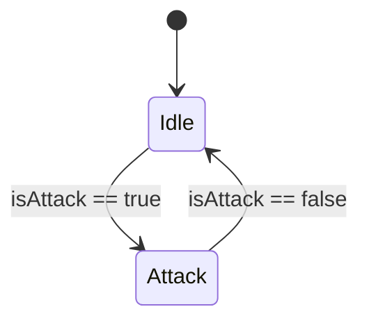

# Phase 1: Animation & Animator Controller Setup

## Overview
Set up the Animator Controller and animation events for the Slinger unit, ensuring the `isAttack` (bool) parameter switches states correctly and that the firing frame in `slingshot_Attack.anim` invokes `AttackAnimationFinished()`.

## Requirements
- Functional:
  - Create or configure an Animator Controller `slingshotanimator.controller` with `Idle` and `Attack` states driven by boolean parameter `isAttack`.
  - Add an Animation Event on `slingshot_Attack.anim` targeting `AttackAnimationFinished()`.
- Non-functional:
  - Compatible with Unity 2022+ / 6 Animator YAML formats.
  - Matches the established pattern in `swordsmananimator.controller` and `Animatorarcher.controller`.

## Architecture

- In `slingshot_Attack.anim` at ~0.8-1.0s (or when stone is released), fire event `AttackAnimationFinished`.

## Related Code Files
- Create: `Assets/Animations/Blue/slingshot/slingshotanimator.controller`
- Modify: `Assets/Animations/Blue/slingshot/slingshot_Attack.anim`

## Implementation Steps
1. Create `slingshotanimator.controller` modeled after `swordsmananimator.controller`:
   - State `slingshot_Idle` using clip `slingshot_Idle.anim` (default state).
   - State `slingshot_Attack` using clip `slingshot_Attack.anim`.
   - Parameter `isAttack` (Bool).
   - Transition `Idle -> Attack` when `isAttack == true`.
   - Transition `Attack -> Idle` when `isAttack == false`.
2. Inspect `slingshot_Attack.anim` keyframe times and add `m_Events` block calling `AttackAnimationFinished`.
3. Verify YAML syntax and GUID references.

## Success Criteria
- [x] `slingshotanimator.controller` compiles in Unity with parameter `isAttack`
- [x] `slingshot_Attack.anim` contains animation event `AttackAnimationFinished`

## Risk Assessment
- *Risk:* Animation event function name mismatch causes Unity console warning.
- *Mitigation:* Ensure function name exactly matches `AttackAnimationFinished` as defined in `Soldier.cs` line 560.
