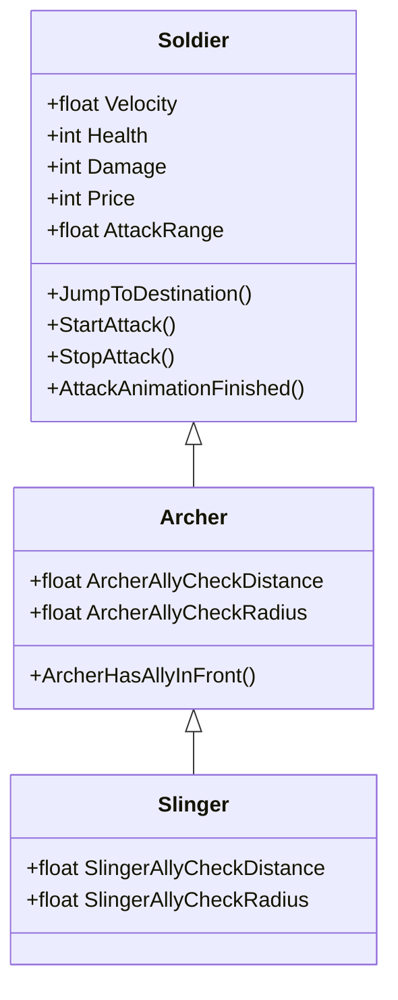

# Phase 2: Slinger Component Script

## Overview
Implement `Assets/Scripts/NPC/Slinger.cs`, subclassing `Archer` (or `Soldier`) with skirmisher-specific behaviors: mid-range detection (4.5m), skirmisher ally-blocking logic, and light skirmisher default stat initialization.

## Requirements
- Functional:
  - Slinger inherits target acquisition and ally-blocking behavior so it doesn't push into melee danger.
  - Defaults:
    - `AttackRange = 4.5f`
    - `Health = 25`
    - `Damage = 8`
    - `Price = 15`
    - `Velocity = 3.5f`
    - `SlingerAllyCheckDistance = 1.0f`
    - `SlingerAllyCheckRadius = 0.4f`
- Non-functional:
  - Clean C# code conforming to existing project standards in `Soldier.cs` and `Archer.cs`.
  - Compiles cleanly with `dotnet build`.

## Architecture

## Related Code Files
- Create: `Assets/Scripts/NPC/Slinger.cs`

## Implementation Steps
1. Create `Assets/Scripts/NPC/Slinger.cs` extending `Archer` (or `Soldier`).
2. Provide skirmisher defaults in `Awake()` / inspector fields.
3. Add custom gizmo debugging for Slinger's 4.5m range and ally-blocking sphere.
4. Run `dotnet build Fortress-Clash-.sln` to ensure 0 errors.

## Success Criteria
- [x] `Slinger.cs` created in `Assets/Scripts/NPC/`
- [x] C# build succeeds with 0 errors and 0 warnings

## Risk Assessment
- *Risk:* Extending `Archer` tightly couples Slinger to Archer's ally distance.
- *Mitigation:* Override ally check distance/radius with Slinger-specific parameters (`SlingerAllyCheckDistance = 1.0f`).
