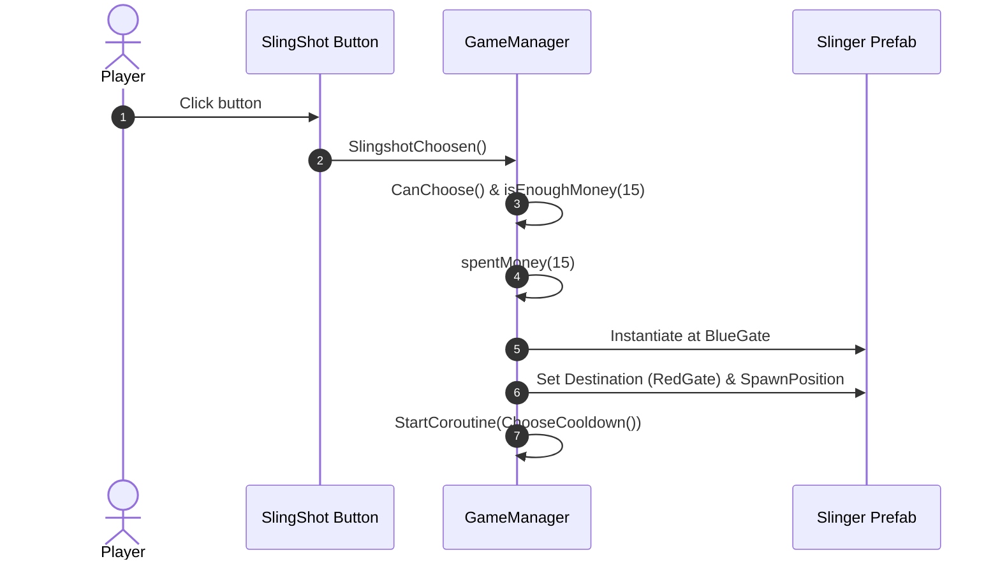

# Phase 3: Slinger Prefab & GameManager Integration

## Overview
Create `Assets/Prefab/Slinger.prefab` assembled with the Slinger sprite, animator controller, collider, rigidbody, and `Slinger` script. Update `GameManager.cs` to expose `public GameObject Slinger;`, implement `SlingshotChoosen()` to spawn Slinger at Blue Gate, and link the prefab reference in `Gameplay.unity`.

## Requirements
- Functional:
  - `Assets/Prefab/Slinger.prefab` configured with:
    - Sprite: `slingshot_4` from `Assets/Textures/Characters/slingshot.png`
    - Animator: `slingshotanimator.controller`
    - Rigidbody2D: Simulated, Freeze Rotation Z
    - PolygonCollider2D / BoxCollider2D matching character body
    - Tag: `ally`
    - `Slinger` component initialized with proper stats
  - `GameManager.cs`:
    - Field: `public GameObject Slinger;`
    - `SlingshotChoosen()`: validates `CanChoose()`, checks `isEnoughMoney(price)`, deducts money, instantiates `Slinger`, assigns destination/spawn positions, and starts cooldown.
  - `Gameplay.unity`:
    - Assign `Slinger` prefab to `GameManager`'s `Slinger` field.
- Non-functional:
  - Exact preservation of existing `Gameplay.unity` objects and references.

## Architecture

## Related Code Files
- Create: `Assets/Prefab/Slinger.prefab`, `Assets/Prefab/Slinger.prefab.meta`
- Modify: `Assets/Scripts/Core/GameManager.cs`
- Modify: `Assets/Scenes/Gameplay.unity`

## Implementation Steps
1. Create `Assets/Prefab/Slinger.prefab` modeled on `Archer.prefab` structure:
   - Wire `SpriteRenderer` with sprite `slingshot_4` (`guid: 54312b8762709d74aa2bb75f8b80973d`, fileID: `-9061095017673790032`).
   - Wire `Animator` with the new controller.
   - Wire `Slinger` script component (`Price: 15`, `Damage: 8`, `Health: 25`, `AttackRange: 4.5`, `Velocity: 3.5`, `BlueSide: 1`).
2. Update `GameManager.cs`:
   - Add `public GameObject Slinger;`
   - In `SlingshotChoosen()`, implement price check, money deduction, instantiation, and destination routing matching `ArcherChoosen()` / `SwordChoosen()`.
3. In `Gameplay.unity`:
   - Bind `GameManager`'s `Slinger` field to the created `Slinger.prefab` GUID.

## Success Criteria
- [x] `Slinger.prefab` is valid Unity YAML with complete components
- [x] `GameManager.cs` builds and handles `SlingshotChoosen()`
- [x] `Gameplay.unity` has `Slinger` assigned on `GameManager`

## Risk Assessment
- *Risk:* Unity YAML GUID mismatch causes missing script or prefab reference in the scene.
- *Mitigation:* Generate valid Unity GUIDs and ensure `meta` files have identical GUID references.
